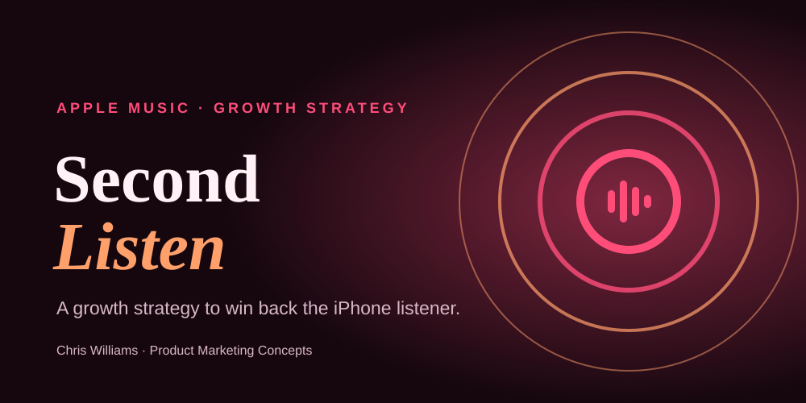
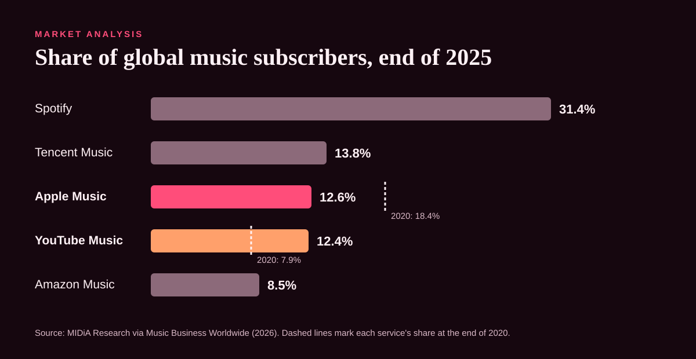
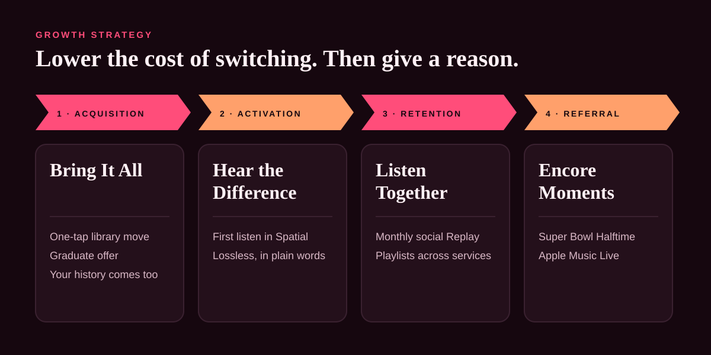
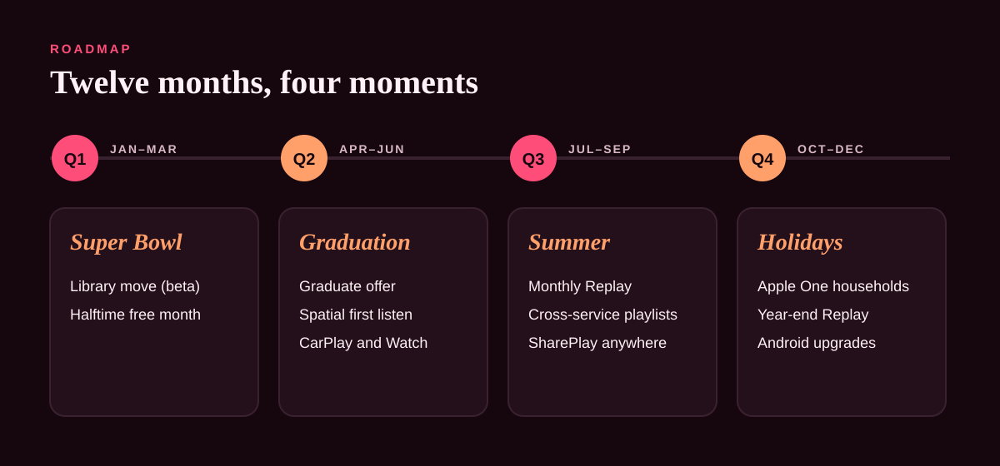

# Apple Music "Second Listen": Growth Strategy 🎧

<kbd>
    
</kbd>

## Project Description 🎨

A growth strategy for Apple Music to win share from Spotify. Apple Music's share of global music subscribers fell from 18.4% at the end of 2020 to 12.6% at the end of 2025, while Spotify held about a third of the market. The diagnosis: Spotify's lead is built on **switching costs** (libraries, listening history and friends), not on a better product. **Second Listen** targets the iPhone owners who still pay for Spotify, removes each switching cost in turn, and pairs each with something only Apple can offer, across four growth levers, a 12-month roadmap and KPIs with guardrails. It's the companion to the [Spotify "Graduation Day"](https://github.com/Allsar2k/spotify-growth-concept) concept: the same fight from the other side. Both are part of Chris Williams's [Product Marketing Concepts](https://allsar2k.github.io/pmm-portfolio/concepts/).

**[View the concept site →](https://allsar2k.github.io/apple-music-growth-strategy/)**

## Screenshots:

    <kbd></kbd>
    <kbd></kbd>
    <kbd></kbd>

## Technologies Used 💻

### Frameworks
- [x] **Market share analysis** — five-year trend against the field
- [x] **Segment prioritisation** — winnability × value
- [x] **Switching-cost analysis** — what users would lose by leaving, and how to remove it
- [x] **AARRR growth levers** — acquisition, activation, retention, referral
- [x] **Roadmap with KPIs and guardrails** — quarterly releases tied to seasonal moments

### APIs & Web Services
- [x] **GitHub Pages** — hosts the one-page concept site
- [x] **GitHub Actions** — checks the design system's colour contrast on every push

### Data Sources
- [x] **MIDiA Research via Music Business Worldwide** — subscriber market shares, 2020 and 2025
- [x] **Spotify Q3 2025 results** — subscriber totals
- [x] **Public product information** — Apple Music features, plans and partnerships

## Architecture 🏗️

- **Pattern**: market → segments → strategy → roadmap and KPIs
- **Design system**: [Encore](docs/DESIGN.md), with tokens in `assets/tokens.json` and contrast checked by `scripts/check-contrast.mjs`
- **Graphics**: hand-written SVG with titles and descriptions
- **Site**: one static HTML page and one stylesheet, no JavaScript and no tracking
- **Target**: any modern browser; WCAG 2.2 AA

## Features 🌟

- 📊 **[Market analysis](docs/01-market-analysis.md)** — why Apple Music has been losing share, and where it's ahead
- 🎯 **[Target segments](docs/02-target-segments.md)** — iPhone Spotify loyalists, graduates, households, Android
- 🔁 **[Growth strategy](docs/03-growth-strategy.md)** — Bring It All, Hear the Difference, Listen Together, Encore Moments
- 🗓️ **[Roadmap and KPIs](docs/04-roadmap-and-kpis.md)** — four quarters, metrics, guardrails and risks
- 🎨 **[Design system](docs/DESIGN.md)** — Encore palette, type and motif

## Contributing ⚙️

Switched services yourself, or have data on why people do? Open an issue or fork the repository and send a pull request. Run `node scripts/check-contrast.mjs` before proposing colour changes.

## License 🪪

Site code is MIT licensed. Strategy documents and graphics © Chris Williams; see [LICENSE](LICENSE). This is an independent concept and is not affiliated with or endorsed by Apple Inc. or Spotify.

