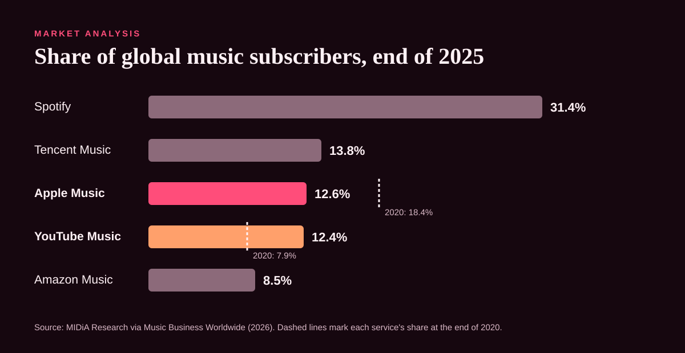

# 01 · Market analysis

## Where things stand

The global music subscription market reached about **921.6 million** subscribers in 2025, up 10.1% (MIDiA Research via Music Business Worldwide, 2026). Spotify leads with almost a third of it. Apple Music has been losing share for five years.

| Service | Share, end of 2025 | Share, end of 2020 | Trend |
|---|---|---|---|
| Spotify | **31.4%** | — | Leader; profitable; 281M Premium subscribers in Q3 2025 |
| Tencent Music | 13.8% | — | Mostly China |
| Apple Music | **12.6%** | **18.4%** | Down almost 6 points in five years |
| YouTube Music | 12.4% | 7.9% | Up 4.5 points, close to passing Apple |
| Amazon Music | 8.5% | — | Bundled with Prime |

Sources: MIDiA Research figures reported by Music Business Worldwide (2026). Platforms don't publish exact subscriber counts by service; these are analyst estimates.

## Why Apple Music is losing share

The market grew, and Apple Music's subscriber base didn't keep pace. Three patterns explain most of it:

1. **Apple Music grows where the iPhone grows, and only there.** It's the default on iPhone, but most of the world's smartphones run Android, where Apple Music is a download and Spotify is the habit.
2. **The bundle competitors caught up.** YouTube Music rides on YouTube Premium; Amazon Music rides on Prime. Apple One does the same, but only for people already inside Apple's ecosystem.
3. **Spotify owns the social layer.** Wrapped, Blend, Jam and shareable playlists make Spotify the service your friends are on. Apple Music's editorial quality and audio are strong, but listening on it is mostly solitary.

## Where Apple Music is genuinely ahead

| Advantage | Why it matters |
|---|---|
| Lossless and Spatial Audio at no extra cost | A real product difference, but most listeners don't know or can't hear it on their headphones. |
| Deep iPhone, AirPods, Apple Watch and CarPlay integration | The best experience on the devices hundreds of millions of people already carry. |
| Editorial and live: Apple Music 1 radio, Apple Music Live, the Super Bowl Halftime Show sponsorship | Cultural moments Spotify doesn't own. |
| Student plan includes Apple TV+ in the US | A bundle advantage at the age where habits form. |

## The gap this strategy goes after

**There are many iPhone owners who pay for Spotify.** They already have Apple Music installed, AirPods in their ears and an Apple Account with a card on file. They stay on Spotify because of their library, their playlists and their friends. That's a switching-cost problem, not a product problem, and switching costs can be lowered.

## Sources

- Music Business Worldwide. (2026). *The music industry is closing in on a billion global subscribers, with Spotify out in front*. https://www.musicbusinessworldwide.com/the-music-industry-is-closing-in-on-a-billion-global-subscribers-with-spotify-out-in-front/
- MIDiA Research. (2026). *Music subscriber market shares Q4 2025: The chess board is set*. https://www.midiaresearch.com/blog/music-subscriber-market-shares-q4-2025-the-chess-board-is-set
- Music Business Worldwide. (2025, November). *Spotify subscriber base grew by 5m to 281m in Q3*. https://www.musicbusinessworldwide.com/spotify-posts-680m-operating-profit-for-q3-as-subscriber-base-grows-by-5m-to-281m-paying-users
