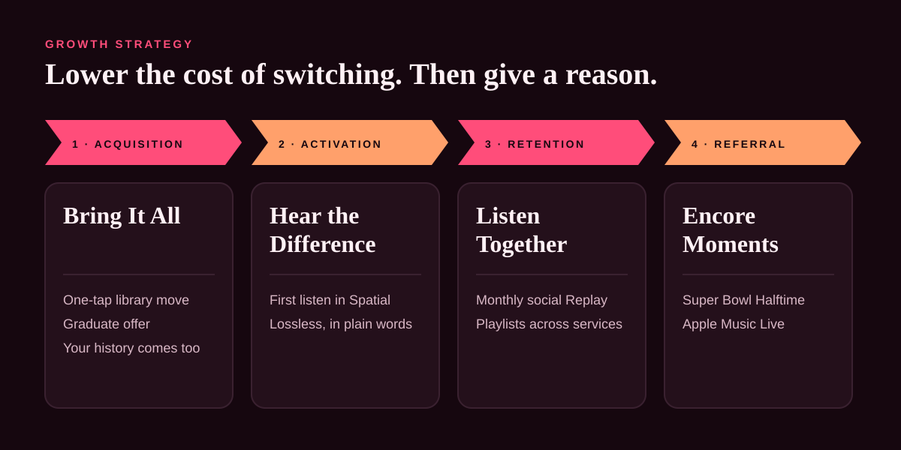

# 03 · Growth strategy: "Second Listen"

**Strategy in one line:** *Lower the cost of switching to zero, then give people something worth switching for.*

Spotify's lead isn't built on a better product. It's built on what people would lose by leaving: their library, their history and their friends. "Second Listen" attacks those switching costs one by one, and pairs each with something only Apple can offer.

## Lever 1 · Bring It All *(acquisition)*

**Remove the "all my music is on Spotify" barrier.**

- **One-tap library move:** a first-party import inside Apple Music that brings over playlists, liked songs and followed artists from another service, built into onboarding rather than left to third-party apps.
- **"Your history comes too":** use the imported listening to seed recommendations from day one, so the first week doesn't feel like starting over.
- **Graduate offer:** in the weeks when Spotify Student ends, a graduate trial (three months included) promoted on campus and in the App Store.

**Measure:** trial starts from people who complete an import; share of imported libraries over 500 songs.

## Lever 2 · Hear the Difference *(activation)*

**Turn Apple Music's best feature, sound, into something people notice in the first five minutes.**

- **"First listen" moment:** when someone with AirPods starts a trial, play one personalised track in Spatial Audio with a one-line explanation. Don't describe it; let them hear it.
- **Lossless explained in plain words** at the moment it matters (wired headphones, HomePod), not in a settings menu.
- **Device moments:** CarPlay and Apple Watch set-up prompts that make Apple Music the default during the trial.

**Measure:** share of trial users who play Spatial Audio in week 1; listening days in week 2.

## Lever 3 · Listen Together *(retention)*

**Close the social gap that keeps friends on Spotify.**

- **Monthly Replay, made social:** Apple Music Replay as a monthly, shareable story, not a once-a-year moment, so there's always something to post.
- **Group listening across services:** a shared playlist link that opens and plays for friends who don't have Apple Music yet, with a free week to listen together. Your friends become your acquisition channel.
- **SharePlay everywhere:** in the car, on HomePod, at a party, with one tap from Control Center.

**Measure:** share of subscribers who share or collaborate monthly; day-90 retention of users who joined through a friend's link.

## Lever 4 · Encore Moments *(referral and brand)*

**Use the cultural moments Apple already pays for as acquisition events.**

- **Super Bowl Halftime Show:** the week before and after, a free month for new subscribers with the headliner's catalogue in Spatial Audio, and a halftime "Replay" story to share.
- **Apple Music Live:** exclusive concerts that stream free for a week, then sit behind the subscription.
- **Apple Music 1 hosts as guides** for new subscribers: "start here" stations by genre.

**Measure:** trial starts during each moment; trial-to-paid conversion vs. normal weeks.

## What we won't do

- **Compete on price.** A permanent discount would shrink revenue and train subscribers to wait for deals. Trials and bundles, yes; a price war, no.
- **Chase podcasts and audiobooks.** That's Spotify's investment, not our advantage.
- **Make Apple Music worse on Android to sell iPhones.** Android is the long-term growth market; a good Android app is part of the strategy, not a threat to it.
