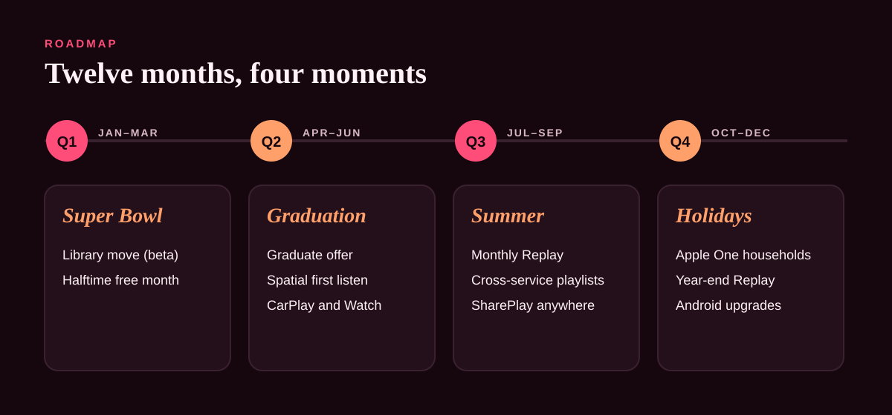

# 04 · Roadmap and KPIs

## Twelve-month roadmap

| Quarter | Ship | Lever | Why now |
|---|---|---|---|
| **Q1** (Jan–Mar) | One-tap library move (beta); Super Bowl Halftime "free month" | Bring It All, Encore Moments | The Super Bowl is in February; the import has to exist before the first big moment |
| **Q2** (Apr–Jun) | Graduate offer; "first listen" Spatial Audio moment; CarPlay and Watch prompts | Bring It All, Hear the Difference | Graduation season, when Spotify Student ends |
| **Q3** (Jul–Sep) | Monthly Replay stories; cross-service shared playlists; SharePlay from Control Center | Listen Together | Summer is peak social listening: road trips, parties, festivals |
| **Q4** (Oct–Dec) | Apple One household push; year-end Replay; Android app improvements | Listen Together, Bring It All | Holiday device gifting brings new iPhones, AirPods and HomePods |

## KPIs

### Headline

**Net subscriber share gain:** Apple Music's share of global music subscribers, as reported by independent analysts (e.g. MIDiA). Concept target: stop the decline in year 1 (hold 12.6%), and return to growth in year 2.

### By lever

| Lever | KPI | What good looks like (concept target) |
|---|---|---|
| Bring It All | Trial starts from users who imported a library | 30% of new trials |
| Bring It All | Graduate offer trial-to-paid conversion | Above the average trial |
| Hear the Difference | Trial users who play Spatial Audio in week 1 | 60% of AirPods owners |
| Listen Together | Subscribers sharing or collaborating each month | 25% |
| Listen Together | Day-90 retention of users who joined through a friend's link | 10 points above the average |
| Encore Moments | Trial starts in Super Bowl week vs. a normal week | 3× |

### Guardrails

- **Average revenue per subscriber:** trials and bundles mustn't erode it.
- **Churn at trial end:** a spike means we're buying trials, not subscribers.
- **Android app rating:** must improve, not slip, as Android investment grows.

All targets are planning assumptions for the concept, not Apple data.

## Risks

| Risk | Response |
|---|---|
| Spotify answers with its own graduate or switching offers | Move first, during graduation season; the library move is the hard-to-copy part. |
| Imports feel incomplete (missing tracks, wrong matches) | Show exactly what came across and what didn't; never silently drop songs. |
| Social features feel bolted on | Start with Replay, which already exists, and make sharing it effortless before building new formats. |
| Regulators scrutinise Apple defaults on iPhone | Win on product and offers, not on making Spotify harder to use. |
